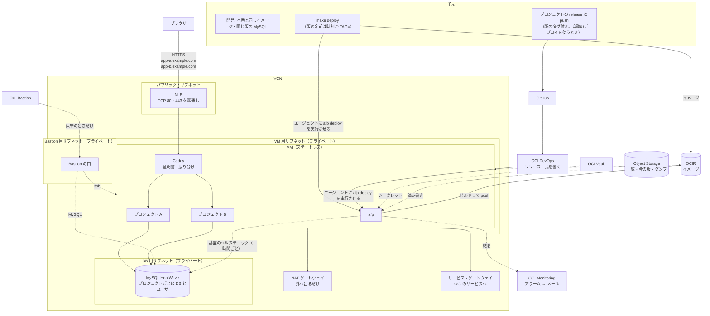
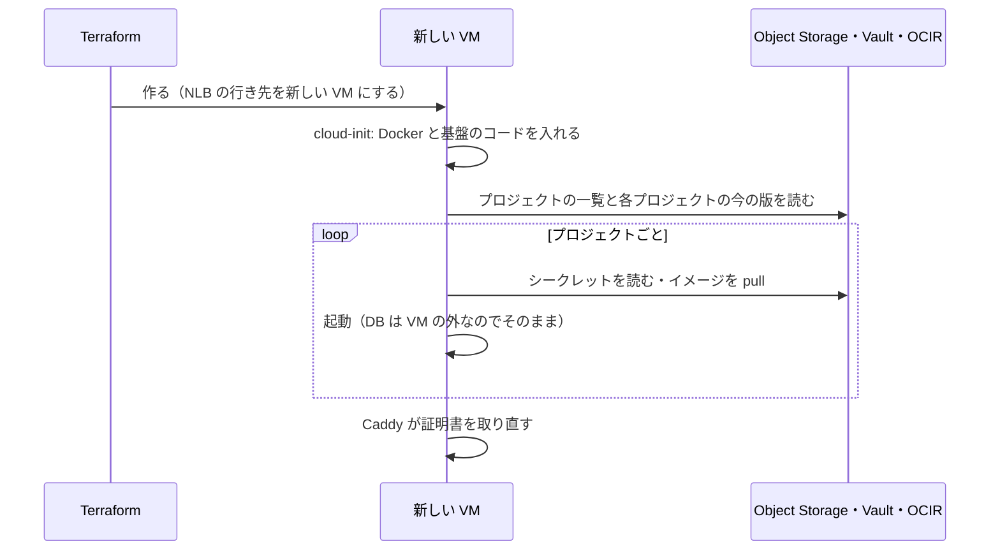

# 02 構成と決定

[01](01_purpose.md) の目的と方針に沿って決めた構成を書く。

## 1. 前提にした無料枠

無料枠の値と出典は [references/oci-free-tier.md](references/oci-free-tier.md) にある。構成を決めるのに効いたのは次の点。

- **VM**: 無料で確実に作れるのは E2.1.Micro（1/8 OCPU・1 GB）の 2 台。A1（合計 2 OCPU・12 GB）は大きいが、リージョンによっては空きが無く作れないことが多い。
- **DB**: MySQL HeatWave（1 ECPU・8 GB。ECPU は OCI の CPU の数え方の単位）が 1 個。小さなアプリを複数載せるには十分。
- **ホームリージョン**: Compute と DB は、ホームリージョンにしか無料で作れない。
- **アイドル回収**: Always Free の Compute は、7 日間使用率が低いと回収されうる。個人用のアプリはこれに当たりやすい。
- **無料でないもの**:
  - **OCI DevOps のビルド**。実行の分だけ課金される（額は未確認）。有料のリソースを使うので、PAYG（従量課金）のアカウントが要る見込み（未確認）。
  - **OCIR の保存**。保存量に応じた料金になりうる。古いものを消して小さく保つ。

## 2. 全体の図

## 3. 部品と役目

| 部品 | 役目 |
|---|---|
| **VM**（OCI Compute） | プロジェクトのコンテナと Caddy を Docker で動かす。`release` ブランチへの push からのデプロイでは、イメージもここでビルドする |
| **Caddy** | 入口。HTTPS を受け、ドメイン名でプロジェクトに振り分ける。証明書（Let's Encrypt）を自動で取得・更新する |
| **NLB**（OCI の Network Load Balancer） | 外からの入口。公開 IP を持ち、TCP の 80 番と 443 番を、そのまま（TLS を解かずに）VM の Caddy へ通す。利用者の IP を書き換えない（§5.4） |
| **OCI DNS** | 基盤の公開 DNS のゾーン。プロジェクトごとの名前（`<プロジェクト>.<ゾーン>`）を、その VM の前の NLB の公開 IP に向ける（§5.4） |
| **`afp`** | 基盤のコマンド（Python の標準ライブラリだけで書く。§5.8）。VM の上で、初期設定・プロジェクトの一覧に合わせた同期（プロジェクトの DB とユーザの作成を含む）・デプロイ・バックアップ・基盤のヘルスチェックを受け持つ。外からは、VM の中のエージェント（Oracle Cloud Agent の Run Command）を通して呼ぶ（§5.6） |
| **MySQL HeatWave** | 全プロジェクトで共有する DB。プロジェクトごとにデータベースとユーザを分ける |
| **OCI Vault** | シークレットの置き場所。生成できる値は Terraform が生成して Vault に置く（値は Resource Manager の state にも残る）。外から持ってくる秘密の値（GitHub のトークン・外部の API キー）は、管理者が手で作る（§5.5） |
| **Object Storage** | プロジェクトの一覧・各プロジェクトの今の版・リリース一式・DB のダンプ・`afp` の操作のログ |
| **OCIR**（OCI のコンテナ・レジストリ。[references/oci-registry.md](references/oci-registry.md)） | ビルドしたイメージ。リポジトリはプロジェクトのサービスごと |
| **OCI DevOps** | リポジトリを伝えたプロジェクトの `release` ブランチへの push を受けて、そのプロジェクトのリリース一式を Object Storage に置き、VM に `afp deploy` を実行させる（§5.6） |
| **OCI Monitoring・Notifications** | 基盤のヘルスチェック（§5.7）の結果を受け、失敗したり届かなくなったりしたらメールで知らせる |
| **VCN** | 基盤のネットワーク。サブネットを役目ごとに 4 つに分ける（§5.4） |
| **OCI Bastion** | 手元からプライベート・サブネットの VM と DB に入るための、一時的な入口（§5.9） |
| **Terraform**（OCI Resource Manager で実行。[references/oci-resource-manager.md](references/oci-resource-manager.md)） | VM の外のものを作る。プロジェクトの一覧から、プロジェクトごとの生成するシークレットとパイプラインも作る。手元の `terraform/` を、そのまま（git に頼らず）送って実行する |

- **VM の外は Terraform、VM の中は `afp`** が受け持つ。`afp` は Terraform が書いたプロジェクトの一覧に従う。
- プロジェクトの DB とユーザは、Terraform でなく VM の `afp` が、Vault に置いた DB の管理者のパスワードで作る。
- **基盤のヘルスチェック** は、VM から HeatWave に問い合わせて基盤が動いているかを確かめること（§5.7）。コンテナが正しく動いているかを確かめる compose の `healthcheck` とは別のもの。
- デプロイに要るファイル一式（リリース一式。プロジェクトのその版の `compose.afp.yaml`）は、バケットに版ごとに置く。VM は使うたびにバケットから取る。
- OCIR のリポジトリは Terraform で作らない。デプロイが、ビルドするサービスのリポジトリが無ければ基盤のコンパートメントに作る。本体の destroy では消えない。
- OCIR へのログインは、手元も VM も、使うたびに OCI の資格から短い期限のトークンを取って行う。auth token は使わない。
- Terraform のスタックは 2 つ。中はどちらもモジュールで分ける。
  - **base**: Terraform の destroy で消せないもの（コンパートメント・Vault・Vault の鍵）と、作り直すと OCI の外の設定を直す要が出るもの（公開 DNS のゾーン。親のゾーンが NS レコードで委任する）だけ。
  - **本体**: それ以外のすべて（ネットワーク・NLB・Bastion・HeatWave・シークレット・バケット・DNS のレコードなど）。本体の destroy の前に、バケットを空にする。
  - 本体は、base のリソースを名前で探す。スタックの間で値を受け渡す仕組みは作らない。
  - 本体のシークレットの名前には、作るたびに変わる接尾辞を付ける。
- **基盤の開発中は、削除を防ぐ仕組みを一切付けない**（Terraform の `prevent_destroy`・HeatWave の削除防止・コンパートメントを消せなくする設定）。
- Terraform の state は Resource Manager が預かる。手元に state を置かない。
- 環境ごとの値（プロジェクトの一覧・DNS のゾーン・通知のメールの宛先・OCID など）は、この公開リポジトリに置かず、別の非公開の設定に置く。
- 基盤が作る OCI のリソースの名前は `<種類>-afp-<識別子>` にする（例: `bucket-afp-main`・`subnet-afp-db`・`trigger-afp-<プロジェクト>`）。識別子は必ず付け、1 つしか無いものは `main`。OCIR のリポジトリは `repo-afp-<プロジェクト>/<サービス>`。名前に英数字しか使えない Bastion は、ハイフンを除く（`bastionafpmain`）。

## 4. 状態の置き場所

VM の中には失って困るものを置かない。

| 状態 | 置き場所 |
|---|---|
| アプリのデータ | MySQL HeatWave |
| シークレット | OCI Vault |
| どのプロジェクトをどのドメインで動かすか | Object Storage（Terraform が書く） |
| 各プロジェクトの今の版 | Object Storage（デプロイが成功したら `afp` が書く） |
| イメージ | OCIR |
| リリース一式 | Object Storage（デプロイが版ごとに置く） |
| 基盤のコード | Object Storage の `platform.tar.gz`（管理者の手元のコードを、そのまま `make platform` が置く。§5.6） |
| HTTPS の証明書 | VM の中。消えたら Caddy が自動で取り直す |
| ログ | VM の中（消えてよい）。`afp` の操作のログは Object Storage |

VM が消えたときは、Terraform で作り直すだけで戻る。

- 外から見える IP は NLB のものなので、VM だけを作り直したときは DNS は変わらない。本体のスタックを作り直して NLB の IP が変わったときも、本体が DNS のレコードを新しい IP に向ける（§5.4）。

## 5. 主な決定

### 5.1 相乗り

- 少ない VM と 1 つの DB に、全プロジェクトを相乗りさせる。VM が落ちると全プロジェクトが止まる。

### 5.2 VM

- OCI Compute の VM の上で Docker を使う。OS は Oracle Linux 9。
- VM は、取れるときは A1（1 OCPU・6 GB）、取れないときは E2.1.Micro にする。どちらにするかは、管理者が Terraform の変数で決める。A1 が取れずに作れなければ、変数を替えて流し直す。自動では切り替えない。
- A1 は arm64、E2.1.Micro は amd64。イメージは、そのときの VM の CPU の種類向けにだけビルドする。VM の CPU の種類を替えたら、載っている全プロジェクトをビルドし直す。
- VM にはスワップを置く。kdump は使わない（カーネルが落ちたときの記録のために、メモリを取っておかない）。
- アイドル回収は、作り直せば戻ることで備える（§4）。わざと負荷をかけて避けることはしない。
- `release` ブランチへの push からのデプロイでは、VM がその場でビルドし、イメージを OCIR に置く。前の版への戻しと、VM を作り直したあとの起動では、ビルドせず OCIR から取る。手元からのデプロイは、手元でビルドする。

### 5.3 DB

- MySQL HeatWave の Always Free を、全プロジェクトで共有する。手元では公式の `mysql` のコンテナを本番と同じ版・同じ設定で動かす。
- HeatWave の Always Free は保守のたびに最新の版へ上がるので、手元の版を追いかける。バックアップは 1 日分しかないので、基盤が毎日ダンプを取る。
- 基盤が定期的に触る（§5.7 のヘルスチェック）。

### 5.4 入口とネットワーク

- VCN のサブネットを、役目ごとに 4 つに分ける。
  - **パブリック**: NLB だけを置く。外から入れるのはここだけ。
  - **VM 用**（プライベート）: VM。公開 IP を持たない。外へは NAT ゲートウェイ（外へ出るだけの出口）から、OCI のサービスへはサービス・ゲートウェイ（インターネットを通らない出口）から出る。
  - **DB 用**（プライベート）: MySQL HeatWave。VM と Bastion の口からの MySQL だけを受ける。
  - **Bastion 用**（プライベート）: Bastion の口（§5.9）。VM の ssh と DB の MySQL にだけ出られる。
- 入口は、VM ごとに 1 つの NLB（L4）。TCP の 80 番と 443 番を VM の同じ番号へ通す。TLS は解かず、利用者の IP を保持したまま渡す。NLB は Always Free に入っている（[references/oci-network-load-balancer.md](references/oci-network-load-balancer.md)）。
- Caddy を 1 つ置き、ドメイン名（TLS の SNI と HTTP の Host ヘッダ）でプロジェクトに振り分ける。パスでは分けない。
- 基盤が公開 DNS のゾーンを 1 つ持つ（OCI DNS）。プロジェクトのドメインは `<プロジェクトの名前>.<ゾーン>` に決まる。ゾーンの外のドメインは扱わない。
- 本体のスタックが、プロジェクトごとに A レコードを作り、そのプロジェクトの VM の前の NLB の公開 IP に向ける。NLB の IP は予約しない（NLB を作り直さない限り変わらず、変わればレコードも本体が直す）。親のゾーンからの委任（NS レコード）は、管理者が最初に一度だけ行う。
- DNS の問い合わせには料金がかかる（Always Free に入っていない。ゾーンそのものは無料）。
- **80 番は常に全体に開ける**。443 番は、全体に開けるか、決めた IP からだけにするかを切り替えられる。絞るのは入口（パブリック・サブネット）で、VM は NLB を通ったものだけを受ける。

### 5.5 シークレット

- プロジェクトに渡す値は 3 種類に分ける。
  - **設定値**（秘密でないもの）: 非公開の設定に、値をそのまま書く。Vault を通さない。
  - **生成するシークレット**: Terraform が生成して Vault に置く。
  - **手で作るシークレット**（外から持ってくる秘密の値）: 管理者が Vault に手で作り、非公開の設定にはその OCID だけを書く。Terraform は作らない。
- **Terraform が作ったものを、人やスクリプトがあとから上書きすることはしない**。GitHub のトークンも手で作るシークレットにする。webhook の Secret は、トリガーと一緒に `make apply` の中のスクリプトが作り、トリガーと一緒に消す。
- 手で作るシークレットは、基盤の Vault の、基盤のコンパートメントに置く。本体のスタックを作り直しても残る。
- VM はシークレットをインスタンス・プリンシパル（VM そのものに与える権限）で読み、設定値と一緒に、`docker compose` を起動するプロセスの環境変数として渡す。環境変数のファイルは作らない。
- **コンテナからは、VM のメタデータ（`169.254.169.254`）への通信を、VM の初期設定で落とす**。同じ IP の 53 番（VCN の DNS）だけは通す。メタデータの古い口（v1）も止める。

### 5.6 デプロイ

- デプロイは、管理者が手元から行う（`make deploy`）か、自動で行う。
- 手元からのデプロイは、プロジェクトのディレクトリをそのまま使い、git を前提にしない（コミットやタグが無くてよい）。版の名前は、指定しなければ UTC の時刻（例: `20261124T012345Z`）、指定すればその名前。同じ名前を指定すれば上書きする。
- 自動のデプロイでは、**プロジェクトのリポジトリ** の `release` ブランチに push すると、そのプロジェクトだけをビルドし、VM でデプロイするところまで自動で行う。デプロイした版の名前は、`release` の先頭のコミットに付いた `v` で始まるタグ（例: `v1.2.3`）の名前そのもの。そのようなタグが無い、または複数あるときは、デプロイしない。
- パイプラインは、プロジェクトの一覧でリポジトリを伝えたプロジェクトにだけ作る。伝えないプロジェクトは、管理者が手元からデプロイする（下の「DevOps が使えないとき」と同じ道）。伝えるかは、あとから変えられる。
- **基盤のコードは、git とタグに頼らずに VM に届ける**。`make platform` が、管理者の手元のコードをそのまま（コミットしていなくても）固めて Object Storage に置き、VM はそれを取って入れ替える。自動のデプロイのビルドも、そこから基盤のスクリプトを取る。基盤のリポジトリのタグは、管理のために任意で付けるもので、デプロイには関係しない。
- 入れ替えるのは、VM の起動のたびと、管理者が Run Command で呼んだときに流れる起動のスクリプト（`afp` の外の固定のスクリプト）で、`afp` 自身は入れ替えない。起動のスクリプトそのものは、VM を作り直したときに入る。
- VM でデプロイを実行するのは、DevOps の **インスタンス・グループへのデプロイ**。VM の中の **Oracle Cloud Agent**（OCI のイメージに入っているエージェント）の **Run Command** のプラグインが、`afp deploy <プロジェクト> <版>` を実行する（[references/oci-devops.md](references/oci-devops.md)・[references/oci-run-command.md](references/oci-run-command.md)）。
- DevOps が使えないときは、手元から同じ Run Command を直接呼んで `afp deploy` を実行させる。
- デプロイには ssh を使わない。

OCI DevOps のうち、共有するものとプロジェクトごとのものは次のとおり。

| 共有する（基盤が1つだけ持つ） | プロジェクトごと（リポジトリを伝えたプロジェクトに、`make apply` が作る） |
|---|---|
| DevOps のプロジェクト（パイプラインを入れる箱） | ビルドのパイプライン・デプロイのパイプライン |
| GitHub への接続（非公開のリポジトリを読むためのトークンは基盤で 1 本。管理者が手で作るシークレット） | トリガー（どのリポジトリの、`release` への push で動くか）と webhook の Secret（Vault。トリガーと一緒に作り、一緒に消す） |
| 通知の宛先（成否のメール） | イメージとリリース一式の置き場所 |
| DevOps に与える OCI の権限 | — |

- トリガーと webhook の Secret だけは Terraform で作らず、`make apply` の中で OCI CLI が作る・消す・絞りを直す（Terraform では webhook の Secret が得られないため）。`make apply` で設定どおりになり、`make destroy` で消えるのは、ほかのリソースと同じ。
- GitHub の側の webhook は、パイプラインを作ったときに、管理者が GitHub の画面で登録する。URL は `make apply` が表示し、Secret は Vault からコピーする。
- **パイプラインはプロジェクトごとに独立させる**。あるプロジェクトの push は、そのプロジェクトのパイプラインだけを動かす。
- ビルドは、プロジェクトの間で並んで走ってもよい。
- VM の上のデプロイは、1 つずつ行う（`afp` がロックを取る）。後のものは前のものが終わるのを待つ。
- リポジトリを伝えたプロジェクトは、基盤の雛形に沿った DevOps のビルドの手順（`build_spec.yaml`）を、自分のリポジトリに置く。雛形の決まった部分が、その版のソースと `compose.afp.yaml` を Object Storage に置き、VM の `afp deploy` がそれをビルドしてデプロイする。プロジェクトは、決まった部分の前に自分の手順を足せる。

### 5.7 基盤の監視

- VM が定期的に（1 時間ごと）HeatWave に問い合わせ、結果を OCI Monitoring に送る。失敗したときと、届かなくなったとき（VM が止まった）にアラームでメールする。
- アプリの監視は各プロジェクトの責任とし、基盤は用意しない。

### 5.8 `afp`

- Python で書き、サブコマンドは `argparse` で作る。外部のライブラリは使わない（OCI の SDK も使わない）。VM の OS の標準の python3（3.9）で動かす。
- OCI のサービスは OCI CLI を、コンテナは `docker compose` を、DB は `mysql` のクライアントを、`subprocess` から呼ぶ。
- 使い方は `--help` に置く。

### 5.9 手元からの保守

- Bastion の口は、Bastion 用のサブネットに置く（§5.4）。
- 手元から DB に入るときは、OCI Bastion のポート転送を使う（[references/oci-bastion.md](references/oci-bastion.md)）。セッションの鍵は、そのたびに作って捨てる。
- 手元から VM に ssh で入るのは保守のときだけで、Bastion の Managed SSH のセッションを使う。鍵はそのたびに作って捨て、VM に固定の鍵を置かない。22 番は外に開けない。

### 5.10 作らないもの

- 既製の PaaS（Dokku・Coolify など）・Kubernetes・Nomad
- 共通のログイン（SSO）。各アプリが自分でログインを持つ
- 自前の監視の仕組み（Prometheus など）
- ステージング環境
- 頻度の低いことを自動で見張る仕組み（DB の版のずれの検出・A1 の取り直しなど）
