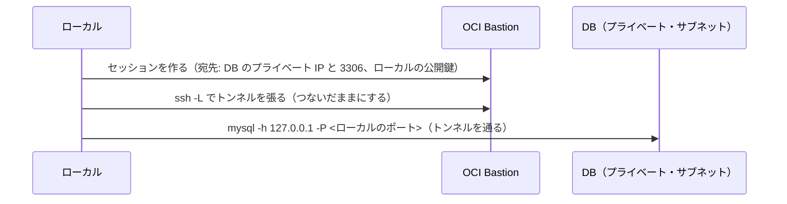

# OCI Bastion

外から直接届かないリソース（プライベート・サブネットの VM や DB）に、ローカルから一時的に入るための OCI のサービス。踏み台のサーバを自分で立てる代わりに、OCI が用意する踏み台を使う。

- **確かめた日**: 2026-11-09（Oracle の公式ドキュメントと、実際にポート転送で MySQL に入った結果）。§4 は 2026-11-13（VM に ssh で入った結果）。§5 は 2026-11-25（公式ドキュメントと、実際に Managed SSH で VM に入った結果）

## 1. 要点

| 項目 | 内容 |
|---|---|
| 料金 | かからない（サービスの制限はある） |
| 範囲 | 1 つの Bastion は 1 つの VCN に結び付く。ほかの VCN のリソースには届かない |
| 入れる人 | IAM のポリシーで決める。さらに、Bastion に登録した IP の範囲（client CIDR の許可リスト）からしか接続できない |
| 認証 | セッションを作るときに ssh の公開鍵を渡し、接続するときに対の秘密鍵を使う |
| 時間 | セッションは時間切れで使えなくなる。最長の時間は Bastion ごとに 30〜180 分（3 時間）で決める。時間前に消すこともできる |

## 2. セッションの種類

| 種類 | 対象に要るもの | できること |
|---|---|---|
| Managed SSH | Linux の公式イメージ・OpenSSH のサーバ・Oracle Cloud Agent と、その Bastion のプラグインの有効化 | Compute の VM に ssh で入る |
| **SSH ポート転送** | **何も要らない** | ローカルのポートを、対象の決めたポートにつなぐ。MySQL・RDP など、たいていの TCP の通信に使える |
| 動的ポート転送（SOCKS5） | 何も要らない | 対象のサブネットにつなぎ、どのリソース・ポートに行くかはローカルで選ぶ |

## 3. ポート転送で DB に入る流れ

1. Bastion を作る。対象の VCN のサブネットと、接続を許すローカルの IP の範囲を決める。
2. 対象の側のセキュリティ・リスト（または NSG）で、Bastion から対象のポート（MySQL なら 3306）への通信を許す。
   - Bastion は、対象のサブネットの中に自分の接続口（プライベート・エンドポイント）を置く。この接続口にも、**そのサブネットのセキュリティ・リストが掛かる**。
   - そのため、入る向き（ingress）だけでなく、**接続口から対象へ出る向き（egress）も許す** 必要がある。egress の規則が無いと、ssh のトンネルは張れるのに、対象からの応答が来ない（MySQL では接続の最初の応答を待って切れる。実測）。
3. セッションを作る。種類は「SSH ポート転送」、宛先は対象のプライベート IP とポート。ローカルの ssh の公開鍵を渡す。
   - CLI では `oci bastion session create-port-forwarding --bastion-id <Bastion の OCID> ...`
4. セッションの詳細に表示される ssh のコマンド（`ssh -i <秘密鍵> -N -L <ローカルのポート>:<対象の IP>:<対象のポート> ...` の形）をローカルで実行し、つないだままにする。
5. 別のターミナルから、`127.0.0.1:<ローカルのポート>` に向けて接続する。

## 4. ポート転送で VM に ssh で入る

- 宛先を VM のプライベート IP の 22 番にしたポート転送のセッションで、VM に ssh で入れた。VM の側に Bastion のプラグインは要らない（実測）。
- §3 と同じく、Bastion の接続口があるサブネットのセキュリティ・リストに、VM の 22 番へ出る向き（egress）を足し、VM の側には接続口のサブネットからの 22 番を許す。
- `ssh -L` でローカルのポートを開く形のほか、`ssh -o ProxyCommand="ssh -W %h:%p <セッション>@host.bastion.<リージョン>.oci.oraclecloud.com" opc@<VM の IP>` の形（1 つのコマンドで入れる）も使えた（実測）。
- セッションが `ACTIVE` になった直後は、数秒の間、SSH 鍵が断られた（`Permission denied (publickey)`）。15 秒ほど待つと通った（実測）。

## 5. Managed SSH のセッションで VM に入る

公式ドキュメントで確かめたこと:

- 対象の VM の Oracle Cloud Agent の **Bastion のプラグイン** を有効にする。既定では無効（「The Bastion plugin is not enabled by default and must be enabled before creating a session.」）。プラグインの有効・無効は、効くまで最大 10 分。
- VM は Linux の公式イメージで、OpenSSH のサーバが動いていること。
- VCN に、ゲートウェイ（サービス・ゲートウェイ・インターネット・ゲートウェイ・NAT ゲートウェイのどれか）と、そこへの経路があること。
- VM のサブネットのセキュリティ・リストで、Bastion の接続口の IP を含む範囲からの 22 番を許す。
- セッションを作るときに、VM の OS のユーザ名（公式のイメージでは `opc`）と ssh の公開鍵を渡す。接続するときは、対の秘密鍵を使う。VM に前もって公開鍵を置く必要は、公式ドキュメントに書かれていない。
- 使う人には、Bastion とセッションを扱う権限に加え、インスタンスと、そのエージェントのプラグインを読む権限（`read instance-agent-plugins`）が要る。
- CLI では `oci bastion session create-managed-ssh --target-resource-id <VM の OCID> --target-os-username opc ...`。

実測（Oracle Linux 9・A1 の VM。作るときに Bastion のプラグインを有効にした。VM はプライベート・サブネットにあり、NAT ゲートウェイとサービス・ゲートウェイがある）:

- VM に前もって公開鍵を置かずに、セッションに渡した SSH 鍵だけで入れた。
- Bastion の手前と VM の両方に同じ SSH 鍵を使い、`ssh -o ProxyCommand="ssh -W %h:%p <セッション>@host.bastion.<リージョン>.oci.oraclecloud.com" opc@<VM の IP>` の形で入れた。
- VM を作って約 10 分後の 1 回目は、セッションを作ってから入れるまで約 8 分かかった。2 回目は約 1 分 40 秒だった。

## 6. 出典

- [Bastion Overview](https://docs.oracle.com/en-us/iaas/Content/Bastion/Concepts/bastionoverview.htm)（セッションの種類・許可リスト・料金）
- [Creating an SSH Port Forwarding Session](https://docs.oracle.com/en-us/iaas/Content/Bastion/Tasks/create-session-port-forwarding.htm)（作り方・最長の時間）
- [Creating a Managed SSH Session](https://docs.oracle.com/en-us/iaas/Content/Bastion/Tasks/create-session-managed-ssh.htm)（Managed SSH の前提）
- [Connecting to a Managed SSH Session](https://docs.oracle.com/en-us/iaas/Content/Bastion/Tasks/connect-managed-ssh.htm)（セキュリティ・リストの規則）
- [Managing Bastions](https://docs.oracle.com/en-us/iaas/Content/Bastion/Tasks/managingbastions.htm)（使う人の権限）
- [Oracle Cloud Agent](https://docs.oracle.com/en-us/iaas/Content/Compute/Tasks/manage-plugins.htm)（プラグインの有効化に要る時間）
